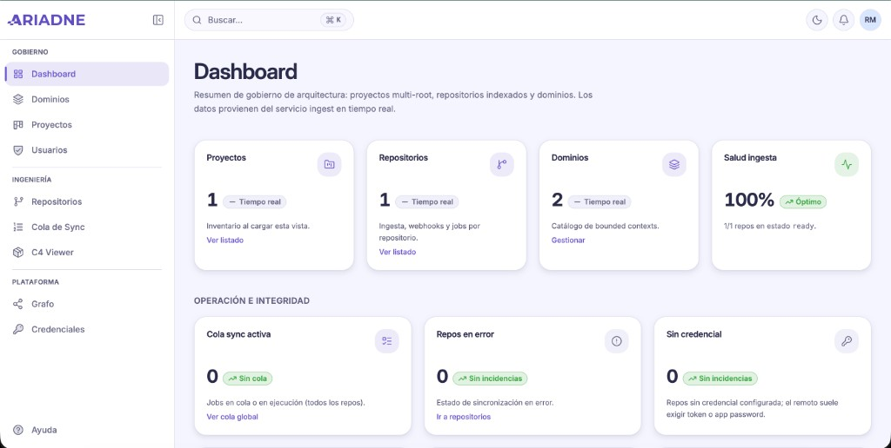
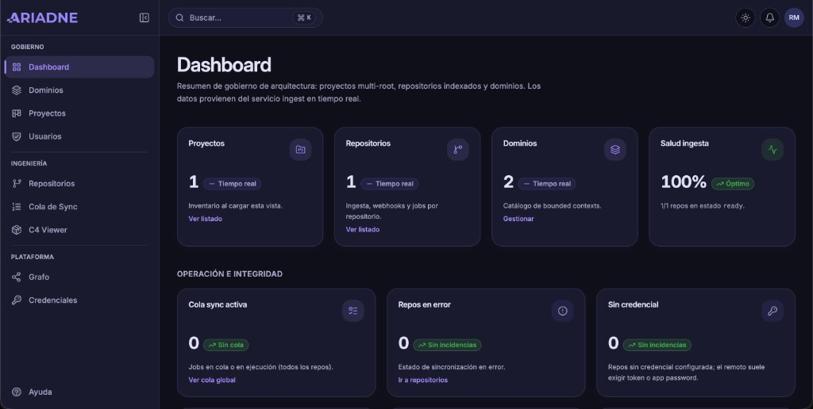
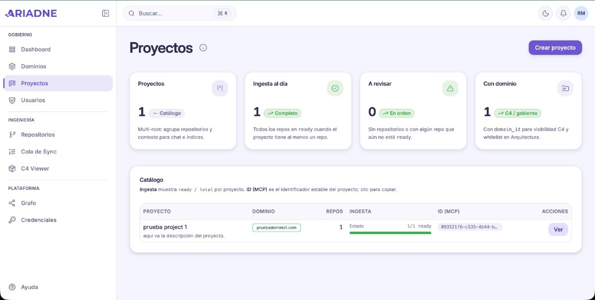
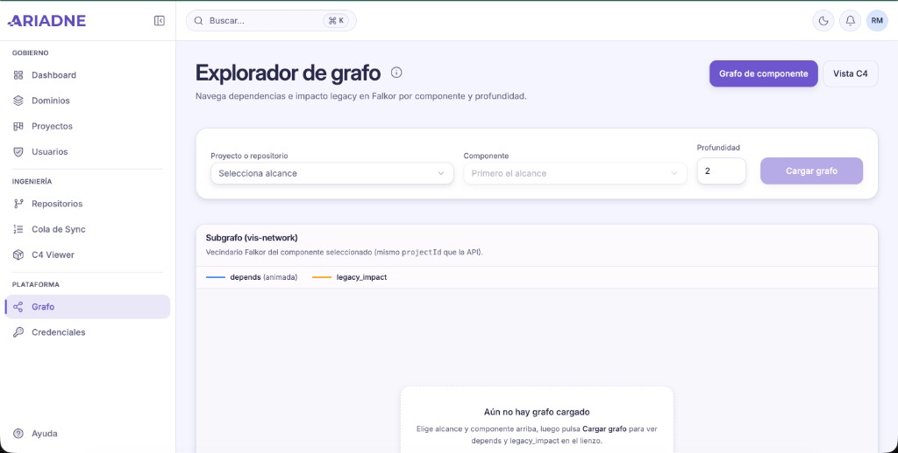
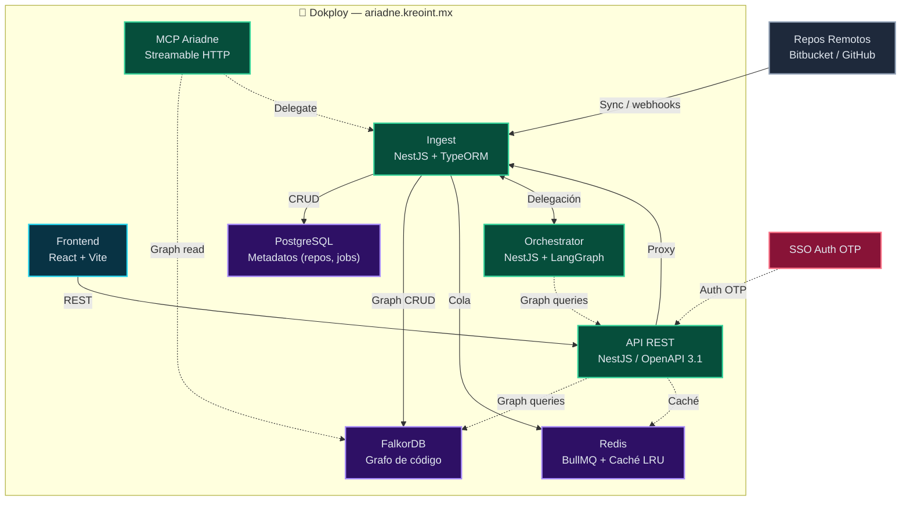

# Ariadne / AriadneSpecs

<p align="center">
 <a href="https://github.com/kreodevs/ariadne">
 
 </a>
</p>

<p align="center">
 Monorepo <strong>NestJS</strong> (ingest, API, orquestador, MCP) + <strong>React</strong> (Vite) + <strong>FalkorDB</strong>, <strong>PostgreSQL</strong> y <strong>Redis</strong>.<br />
 Despliegue listo para <strong>Dokploy</strong> / Docker.
</p>

<p align="center">
 <a href="./LICENSE"></a>
 <a href="https://nodejs.org"></a>
 <a href="https://www.typescriptlang.org"></a>
 <a href="./CONTRIBUTING.md"></a>
</p>

> **Ariadne** es el mapa de arquitectura y el conocimiento vivo del código: sincroniza repositorios, indexa dependencias y reglas de dominio, y ofrece chat NL→Cypher, API, MCP y gobierno de dominios.

Arquitectura: **Ingest** (repos remotos + sync) + **PostgreSQL** (metadatos: repos, proyectos, **dominios de arquitectura**, whitelist proyecto→dominio) + **FalkorDB** (grafo particionado por proyecto/dominio; shadow SDD) + **Chat/Analysis** (NL→Cypher + diagnósticos) + **MCP** (herramientas para la IA) + **gobierno de dominios** (whitelist, shards Falkor).

**[Arquitectura (doc)](docs/notebooklm/architecture.md)** · **[Contribuir](CONTRIBUTING.md)** · **[CHANGELOG](CHANGELOG.md)** · **[AUTHORS](AUTHORS.md)**

---

## ⚡ Conectar un proyecto en 1 paso (Zero-Config Multi-Agente)

Conecta cualquier proyecto a Ariadne en segundos sin compilar nada ni abrir puertos:

```bash
# Caso 1: En tu máquina local (asume http://localhost:3002 por defecto):
ariadne link

# Caso 2: Conectar a servidor en producción (Dokploy) con tu Secret MCP:
ariadne link --server https://ariadne.kreoint.mx --token ari_...

# Caso 3: Para cualquier desarrollador sin Ariadne clonado (directo desde GitHub):
npx -y github:kreodevs/ariadne link --server https://ariadne.kreoint.mx --token ari_...
```

> 🔑 **Token de acceso:** Obtenlo en el panel web (`https://ariadne.kreoint.mx`) ➔ clic en tu **Perfil** (arriba a la derecha) ➔ **Secret MCP** (`ari_...`).  
> 🔒 **Seguridad y red:** En producción (Dokploy), la base de datos FalkorDB permanece aislada en la red interna de Docker (`falkor-net`). El cliente se conecta de forma segura a `https://ariadne.kreoint.mx/mcp` vía **HTTP Streamable / Server-Sent Events (SSE)** con autenticación Bearer Token, sin requerir túneles SSH ni exponer puertos de base de datos a internet.

**¿Qué configura automáticamente este comando?**
1. **Transporte inteligente en `.cursor/mcp.json`:** Detecta si el servidor es remoto (HTTP SSE + Bearer) o local (STDIO nativo).
2. **Cursor Rules Nativas (`.cursor/rules/ariadne-governance.mdc`):** Inyecta la regla con `alwaysApply: true` en el System Prompt de Cursor para forzar la observancia estricta del flujo Two-Gate.
3. **Cursor Skills (`.cursor/skills/ariadnespecs-mcp/SKILL.md`):** Cheatsheet y catálogo de herramientas disponible en la UI de Cursor.
4. **Claude Code (`CLAUDE.md`):** Gobierno canónico en la raíz del proyecto para Claude CLI y Claude Desktop.
5. **Google Antigravity (`.agents/skills/ariadne/SKILL.md`):** Skill empaquetado con frontmatter YAML compatible con Antigravity.
6. **Universal (`AGENTS.md`):** Reglas canónicas para Windsurf, Aider y cualquier otro cliente MCP.
7. **Live Watcher en segundo plano:** Sincronización continua de deltas locales en tiempo real con Write-Ahead Log (WAL) tolerante a fallas.

---

## 🏆 Ventajas sobre otros enfoques (¿Por qué Ariadne?)

La gran mayoría de asistentes de programación basados en IA operan en **"modo adivinación"**: leen fragmentos aislados de código, inventan nombres de propiedades o endpoints y asumen que los cambios no romperán el resto de la aplicación.

Ariadne introduce una capa de **Gobernanza Arquitectónica Activa (Active Architecture Governance)** basada en un grafo de conocimiento vivo en FalkorDB:

### Matriz comparativa

| Capacidad | Asistente IA Estándar (Copilot / Cursor sin Grafo) | RAG Vectorial Simple (Embeddings / Chunking tradicional) | Ariadne Codebase Intelligence (Grafo + Two-Gate) |
|---|:---:|:---:|:---:|
| **Conocimiento de relaciones** | ❌ Ciego a dependientes lejanos | ⚠️ Solo similitud de texto/conceptos | ✅ **Grafo estático real (`CALLS`, `IMPORTS`, `RENDERS`, `USES_HOOK`)** |
| **Detección de radio de impacto** | ❌ No calcula blast radius | ❌ Imposible predecir quién llama a quién | ✅ **Blast radius pre-calculado a 1 y 2 saltos antes de editar** |
| **Prevención de alucinaciones de tipos** | ❌ Inventa nombres de props y APIs | ⚠️ Fragmentos truncados de texto | ✅ **Ego-Graphs con contratos TypeScript exactos extraídos del AST** |
| **Disciplina y compuertas de cambio** | ❌ Genera diffs directos sin auditar | ❌ Sin validación de consistencia | ✅ **Two-Gate Workflow: Gate 1 (Plan) + Gate 2 (Auditoría Bloqueante)** |
| **Sincronización en tiempo real** | ❌ Depende de guardar o git commit | ❌ Requiere re-indexación batch pesada | ✅ **Live Local Watcher (<50ms) + Write-Ahead Log (WAL) offline** |
| **Compatibilidad Multi-Agente** | ⚠️ Configuración manual por IDE | ⚠️ Herramientas propietarias cerradas | ✅ **Setup en 1 paso para Cursor, Claude Code, Antigravity y universal** |
| **Seguridad de infraestructura** | ⚠️ Requiere exponer puertos o túneles | ⚠️ Credenciales dispersas | ✅ **Docker isolated network + Streamable HTTP MCP con Bearer Token** |

---

### Los 5 Pilares Diferenciales de Ariadne

#### 1. Determinismo Estructural vs. Adivinación Heurística
En lugar de saturar la ventana de contexto del LLM con miles de líneas de código irrelevantes, Ariadne recupera **Ego-Graphs**: sub-grafos inmediatos que contienen los contratos de TypeScript, firmas de funciones y endpoints exactos del símbolo a modificar, eliminando alucinaciones de raíz.

#### 2. Arquitectura de Dos Compuertas (Two-Gate Workflow)
- **Gate 1 (`get_modification_plan`):** Ante un requerimiento, Ariadne analiza el grafo y entrega la lista exhaustiva de archivos a modificar (`filesToModify`), el árbol de dependientes y preguntas de negocio de precisión (`questionsToRefine`).
- **Gate 2 (`validate_change_plan`):** Audita el plan estructurado propuesto por la IA antes de permitirle escribir código. Si el agente omitió actualizar un consumidor crítico, el plan se marca como **`BLOCKED`**, evitando regresiones en producción.

#### 3. Auditoría de Símbolo y Pre-Commit
- **`validate_before_edit(nodeName)`:** Obligatorio antes de tocar cualquier componente o función individual. Devuelve su contrato y la lista de todos sus llamadores.
- **`detect_changes()`:** Inspecciona el diff local previo al commit para certificar que ningún archivo externo haya quedado huérfano o roto.

#### 4. Sincronización Local Live con Tolerancia a Fallas (WAL)
No necesitas hacer `git commit` ni `git push` para que Ariadne conozca tu código. El **Live Daemon** integrado observa los cambios de tu buffer/disco y sincroniza deltas en memoria en `<50ms`. Si pierdes conexión a internet o viajas en modo avión, el **Write-Ahead Log (WAL)** en disco encola los cambios y los sincroniza automáticamente al reconectar.

#### 5. Ecosistema Multi-Agente en 1 Solo Comando
Ariadne no te ata a un único editor. Al ejecutar `npx github:kreodevs/ariadne link`, tu repositorio queda instantáneamente protegido con las directivas nativas de **Cursor** (`.cursor/rules/*.mdc`), **Claude Code** (`CLAUDE.md`) y **Google Antigravity** (`.agents/skills/ariadne/SKILL.md`).

---

## Estructura del monorepo

```
ariadne/
├── frontend/ — React (Vite): gobierno, proyectos/repos, dominios, chat, explorador de grafo
├── packages/
│ └── ariadne-common/ — Tipos y utilidades FalkorDB/Cypher compartidas (ingest + MCP)
├── services/
│ ├── api/ — REST NestJS: impacto, contratos, grafo, auth OTP
│ ├── ingest/ — Sync Bitbucket/GitHub, webhooks, índice, chat NL→Cypher, análisis
│ ├── orchestrstrator/ — NestJS + LangGraph (validación SDD)
│ └── mcp-ariadne/ — Servidor MCP (herramientas para agentes / IDE)
├── docs/ — Arquitectura, manual, diagramas, capturas README
├── docker-compose.yml — Stack producción
└── docker-compose.dev.yml — Overrides locales (puertos expuestos, etc.)
```

---

## Capturas de la aplicación

Vista del producto en producción: gobierno (dashboard, proyectos), explorador de grafo y acceso sin contraseña (OTP).

### Acceso seguro (OTP)

<p align="center">
 
</p>

### Dashboard — resumen en tiempo real

<p align="center">
 
 &nbsp;
 
</p>

### Proyectos — catálogo multi-repo e ingesta

<p align="center">
 
</p>

### Explorador de grafo (Falkor / vis-network)

<p align="center">
 
</p>

---

## Deployment

- **ariadne.kreoint.mx** — Frontend + API (un solo dominio; rutas `/repositories`, `/graph/*` enrutadas internamente)

Ver [docs/notebooklm/DEPLOYMENT_DOKPLOY.md](docs/notebooklm/DEPLOYMENT_DOKPLOY.md).

## Servicios

- **falkordb** — Base de datos de grafos (puerto 6379).
- **ingest** — Sync repos, webhooks, shadow `POST /shadow`, índice FalkorDB (sin cartographer separado).
- **redis** — Cola BullMQ (sync) y caché (puerto 6380).
- **postgres** — Repos, sync_jobs, indexed_files, credentials (puerto 5432).
- **ingest** — NestJS: repos Bitbucket/GitHub, full sync, resync, webhook, **alcance de indexado por repo** (`index_include_rules` / UI editar repo), **Chat** (NL→Cypher), **Análisis** (diagnóstico, duplicados, reingeniería), embed-index automático (puerto 3002). Ver [docs/notebooklm/bitbucket_webhook.md](docs/notebooklm/bitbucket_webhook.md) y [MONOREPO_Y_LIMITACIONES_INDEXADO.md](docs/notebooklm/MONOREPO_Y_LIMITACIONES_INDEXADO.md).
- **api** — REST NestJS: impacto, componente, contrato, compare, shadow (puerto 3000).
- **orchestrator** — NestJS + LangGraph: validación SDD (puerto 3001).
- **mcp-ariadne** — MCP stdio: `get_component_graph`, `get_legacy_impact`, `get_contract_specs`, `semantic_search`, `get_file_content`, `validate_before_edit`, `get_project_analysis`, `generate_navigation_map`, `extract_design_tokens`.
- **frontend** — React+Vite: proyectos, repos, **dominios** (CRUD), detalle de proyecto (**pestaña Arquitectura**: dominio, dependencias cruzadas, dominio y whitelist), credenciales, **Chat con repo**, índice FalkorDB, resync (puerto 5173).

## Diagrama de Arquitectura


> 💡 Abre `docs/architecture-diagram.html` en tu navegador para ver el diagrama interactivo con colores, flechas y leyenda. Se actualiza a medida que evoluciona la arquitectura.



## Uso con Docker

1. Coloca el código a analizar en `./src` (o monta otro directorio).
2. Levanta el stack:
 - **Con Colima (local):** `pnpm run docker:up` o `pnpm run dev:infra` — usa `docker-compose.yml` + `docker-compose.dev.yml` (expone puertos para conectar desde el host).
 - **Sin script (local):** `docker compose -f docker-compose.yml -f docker-compose.dev.yml up -d`.
 - **Producción (sin puertos expuestos):** `docker compose -f docker-compose.yml up -d`.
 - Para omitir el script: `SKIP_ENSURE_DOCKER=1 <comando>`.
 - Para bajar el stack y parar Colima: `pnpm run docker:down` o `npm run docker:down`.
3. El Cartographer corre al iniciar e indexa una vez. mcp-ariadne se ejecuta con stdio (para Cursor, configura el MCP apuntando al `node dist/index.js` del servicio mcp-ariadne).

## Documentación

- [CONTRIBUTING.md](CONTRIBUTING.md) — licencia, flujo Git, migraciones, seguridad.
- [docs/JSDOC.md](docs/JSDOC.md) — convenciones JSDoc/TSDoc y mapa de entry points.
- [ariadne-common](packages/ariadne-common/README.md) — Paquete compartido (FalkorDB/Cypher) entre ingest y MCP; uso y **deployment**. (Notas largas: [docs/notebooklm/ariadne-common.md](docs/notebooklm/ariadne-common.md).)
- [Arquitectura](docs/notebooklm/architecture.md)
- [Motor de indexado](docs/notebooklm/indexing_engine.md)
- [Chat y Análisis](docs/notebooklm/CHAT_Y_ANALISIS.md) — Flujo NL→Cypher, diagnósticos, antipatrones, métricas (el retriever usa **cypherShardContexts** del ingest cuando hay whitelist de dominios)
- [Especificación MCP](docs/notebooklm/mcp_server_specs.md)
- [Esquema DB y Cypher](docs/notebooklm/db_schema.md)
- [Manual de uso](docs/manual/README.md) — Puesta en marcha, endpoints, troubleshooting
- [Caché de análisis en ingest](docs/notebooklm/plan-analyze-layer-cache.md) — LRU, Redis, capa extrínseca CALL
- [Capas del diagnóstico](docs/notebooklm/diagnostico-layer-dependencies.md) — intrínseca vs extrínseca
- [Tests (Vitest / Playwright)](docs/notebooklm/TESTING.md)

## Versionado (semver)

- Historial de producto: [CHANGELOG.md](CHANGELOG.md).
- En un **release**, alinear el campo `version` de `package.json` en la raíz, `packages/ariadne-common`, `services/ingest`, `services/api`, `services/mcp-ariadne` y `frontend` cuando el cambio forme parte del mismo entregable. Cada servicio sigue teniendo su propia imagen Docker; el número semver y el CHANGELOG documentan compatibilidad y notas de migración.

## Flujo para desarrollo local

Infraestructura (una vez): pnpm run dev:infra

- Inicia Colima si hace falta
- Sube falkordb, postgres, redis en Docker (ingest/API en el mismo compose)
- No arranca api, ingest ni orchestrator
- Servicios en local (una terminal por servicio):
 - pnpm run dev:api — API (puerto 3000) con watch
 - pnpm run dev:ingest — Ingest (puerto 3002) con watch
 - pnpm run dev:orchestrator — Orchestrator (puerto 3001) con watch
- Orden sugerido
 - pnpm run dev:infra
 - pnpm run dev:ingest (en otra terminal)
 - pnpm run dev:api (en otra terminal)
 - pnpm run dev:orchestrator (en otra terminal)
 - pnpm run dev:front (en otra terminal)

## Despliegue y Configuración Simplificada

El despliegue de Ariadne está diseñado para ser **prácticamente zero-config**. A diferencia de arquitecturas tradicionales que requieren decenas de variables de entorno estáticas, Ariadne utiliza un modelo híbrido:
1. **Solo 3 variables de entorno obligatorias** en tu archivo `.env` o en Dokploy.
2. **Configuración dinámica en caliente desde la UI** (Ajustes de Sistema y Proveedores IA) persistida en PostgreSQL con cifrado AES-256-GCM.
3. **Conexiones internas pre-cableadas** dentro de la red Docker (`falkor-net`).

---

### 1. Variables de Entorno Estrictamente Necesarias (Producción / Dokploy)

Para desplegar una nueva instancia de Ariadne, únicamente necesitas definir las siguientes variables en tu panel de Dokploy o en tu archivo `.env`:

| Variable | Tipo / Ejemplo | Requerida en | Descripción y Propósito |
|---|---|---|---|
| `CREDENTIALS_ENCRYPTION_KEY` | `openssl rand -base64 32` | `ingest` | **Obligatoria.** Clave simétrica de 32 bytes en base64 para cifrar con AES-256-GCM todas las credenciales de repositorios (GitHub, Bitbucket) y las API keys de LLM almacenadas en PostgreSQL. |
| `JWT_SECRET` | `openssl rand -base64 32` | `api` | **Obligatoria.** Secreto criptográfico para la firma y verificación de tokens de sesión y autenticación OTP. |
| `VITE_API_URL` | `https://ariadne.tudominio.com` | `frontend` | **Obligatoria.** URL pública del backend consumida por el frontend SPA. *(Se pasa como build-arg de Docker al compilar).* |

> 💡 **Generación rápida de secretos:**
> ```bash
> openssl rand -base64 32
> ```

#### Variables Opcionales de Arranque / Bootstrap

| Variable | Default | Uso |
|---|---|---|
| `OTP_DEV_MODE` | `false` | Activar con `true` en entornos locales o de prueba sin servidor SMTP para imprimir el código OTP directamente en la consola / respuesta. |
| `JWT_EXPIRES` | `604800` (7 días) | Tiempo de validez en segundos de las sesiones de usuario. |
| `COMPOSE_PARALLEL_LIMIT` | `3` | Recomendado en VPS con recursos limitados (2–4 GB RAM) para limitar builds concurrentes. |

---

### 2. Configuración Dinámica desde la Interfaz Web (Ariadne UI)

**No reinicies contenedores para cambiar credenciales, correo o modelos.** Todo lo operativo se administra desde la plataforma web con recarga inmediata:

#### 🤖 Proveedores IA y Modelos (`/settings/llm`)
- **Proveedor activo:** Alterna entre OpenRouter, OpenAI o LemonData sin tocar archivos de configuración.
- **API Keys cifradas:** Las claves de API se registran desde la UI y se almacenan cifradas en PostgreSQL mediante `CREDENTIALS_ENCRYPTION_KEY`. *Nunca dejes API keys en archivos `.env`.*
- **Modelos independientes:** Configura qué modelo procesa el chat (`LLM_CHAT_MODEL`), cuál realiza el análisis de ingesta (`LLM_MODEL_INGEST`) y cuál genera embeddings (`LLM_EMBEDDING_MODEL` y dimensiones).
- **Parámetros:** Control de temperatura e hiperparámetros de inferencia.

#### ⚙️ Ajustes del Sistema (`/settings/system`)
- **Auth y Correo (`/settings/system` ➔ Auth y correo):**
  - Configuración SMTP completa (Host, Puerto, Usuario, Contraseña cifrada y Remitente).
  - Whitelist de correos autorizados para solicitud de OTP (`emailOtp`).
  - Origen permitido para CORS (`corsOrigin`) y URL de SSO (`ssoUrl`).
- **Red y FalkorDB (`/settings/system` ➔ Red y Falkor):**
  - Sharding por proyecto (`shardByProject`) y sharding por dominio (`shardByDomain`) para monorepos gigantes.
  - Auto-overflow con límite suave de nodos (`graphNodeSoftLimit`).
  - Activación de Cypher Debug para explorador de grafos.
- **Arquitectura C4 (`/settings/system` ➔ C4 / Diagramas):**
  - Generación automática de diagramas C4 (Contexto, Contenedores, Componentes).
  - Ejecución automática tras sincronización completa (`autoOnFullSync`).
- **Observabilidad (`/settings/system` ➔ Observabilidad):**
  - Habilitación de métricas Prometheus (`/metrics`).
  - Logs estructurados de telemetría de chat y límites de archivos para planes de modificación.

#### 🔑 Credenciales de Repositorios (`/credentials`)
- Registra tus Personal Access Tokens (PAT) de GitHub, Bitbucket o GitLab. Quedan cifrados en base de datos y asociados a tus repositorios.

---

### 3. Conexiones Internas de Docker (No requieren configuración)

Los siguientes parámetros ya están resueltos automáticamente en el archivo `docker-compose.yml` a través de la red privada `falkor-net`. **No necesitas añadirlos a tu `.env` ni sobrescribirlos en Dokploy:**

- **Bases de datos:** `FALKORDB_HOST=falkordb`, `FALKORDB_PORT=6379`, `REDIS_URL=redis://redis:6379`, `PGHOST=postgres`, `PGPORT=5432`, `PGUSER=falkorspecs`, `PGDATABASE=falkorspecs`.
- **Servicios internos:** `INGEST_URL=http://ingest:3002`, `ORCHESTRATOR_URL=http://orchestrator:3001`, `ARIADNESPEC_API_URL=http://api:3000/api`, `ARIADNE_API_URL=http://api:3000`.
- **Límites internos:** Todos los límites de procesamiento, truncado de archivos y buffers de herramientas MCP cuentan con valores seguros y calibrados en el código fuente.

---

## Licencia y autoría

- **Licencia:** [Apache License 2.0](LICENSE). Aviso de terceros y copyright del proyecto: [NOTICE](NOTICE).
- **Autores y colaboradores:** [AUTHORS.md](AUTHORS.md) (autor principal: Jorge Correa; sección *Contributors* para quien sume al repo).
- **Cómo contribuir y JSDoc:** [CONTRIBUTING.md](CONTRIBUTING.md) y [docs/JSDOC.md](docs/JSDOC.md).

## Contribución

- Reporta bugs o propone mejoras en [Issues](https://github.com/kreodevs/ariadne/issues).
- Abre un PR siguiendo la guía en [CONTRIBUTING.md](CONTRIBUTING.md).
- Comparte el proyecto si te ha sido útil.

## Gracias a todos los colaboradores ❤

[](https://github.com/kreodevs/ariadne/graphs/contributors)

---

**Licencia:** [Apache License 2.0](./LICENSE) · **Aviso:** [NOTICE](./NOTICE) · **Autores:** [AUTHORS.md](./AUTHORS.md)
